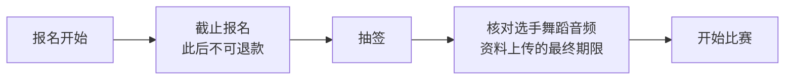
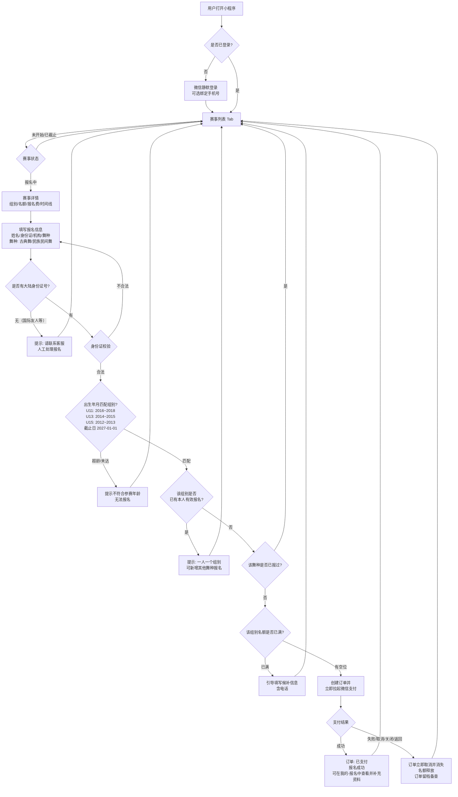
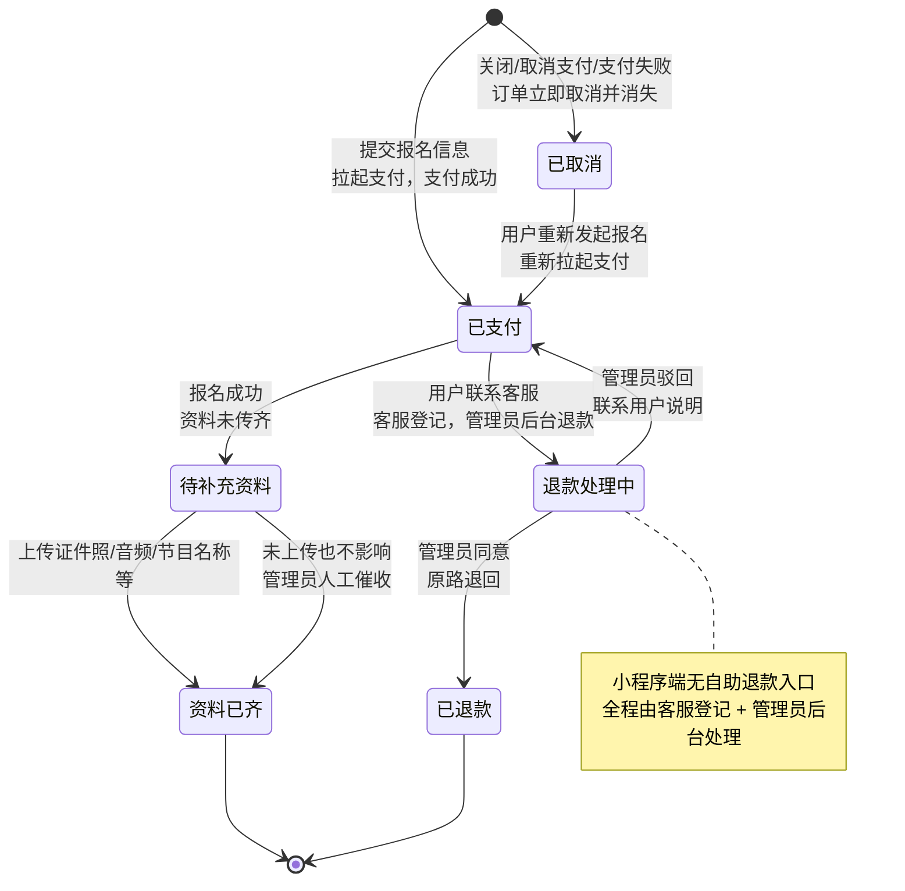
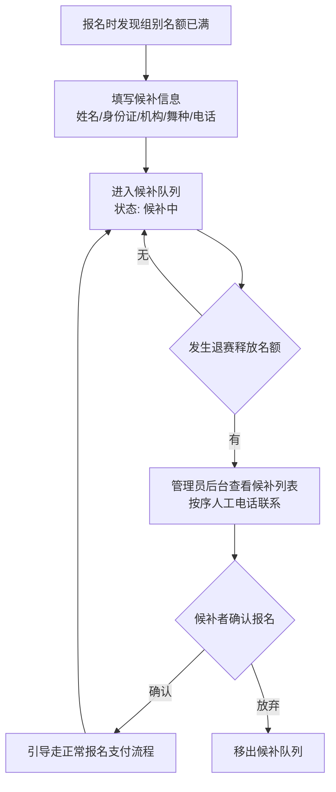
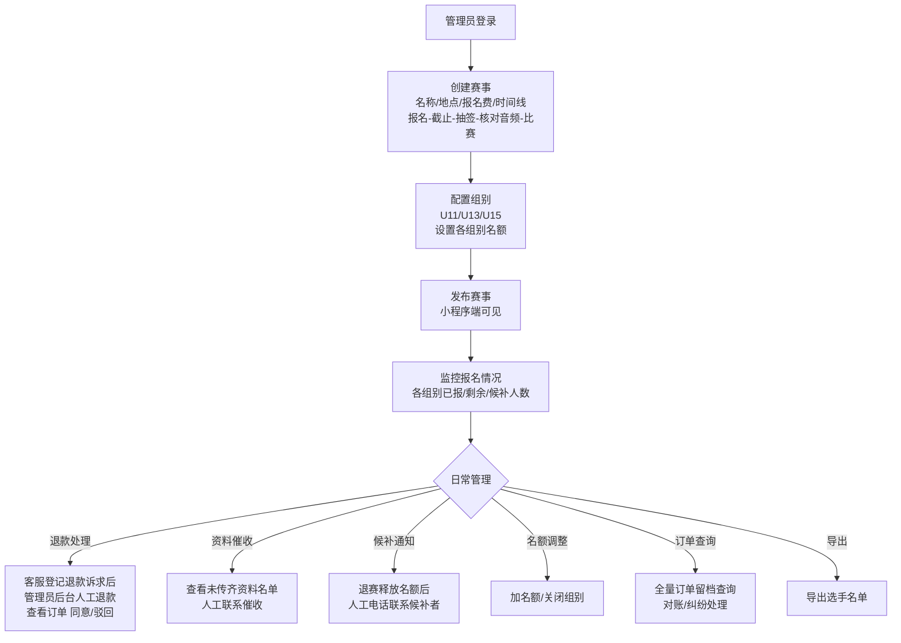

# 优舞盟 小程序报名流程
---

## 1. 已确认的关键决策（速览）

| 维度 | 决策 |
|---|---|
| 支付 | 提交报名即创建订单并拉起支付；点击支付后**立即拉起微信支付**，用户**关闭支付或返回则订单立即取消并消失**（不留待支付订单，不预占名额）；所有订单（含支付失败/取消支付）均留档（防扯皮） |
| 退款 | 小程序端**不提供用户自助退款入口**；如需退款必须**联系客服**，由客服登记后**管理员在后台人工处理退款** |
| 舞种 | 仅 **古典舞** 和 **民族民间舞** 两种 |
| 特殊身份 | 无中国大陆身份证号（如国际友人）无法在线报名，需**联系客服**人工处理 |
| 报名费 | 管理端**创建赛事时设置**（按赛事统一定价） |
| 报名限制 | 同一赛事一人只能报 **1 个组别**，可报 **多个舞种**（分开报名，舞种仅古典舞/民族民间舞）；不支持批量代报 |
| 资料 | 证件照（**png/jpg，≤10MB**）+ 舞蹈音频（**mp3，≤100MB，≤4 分钟**）+ 节目名称为核心，多项可选；**不上传不影响参赛**（人工催收）；**无人工审核**，小程序端自动限制内容 |
| 候补 | 名额满后支持提交候补信息（**须填写电话**），有退赛时管理员人工电话通知 |
| 年龄组别 | U11（2016~2018 出生）/ U13（2014~2015）/ U15（2012~2013），以 2027-01-01 为计算截止日；超龄/未达无法报名 |
| 登录 | 微信静默登录，可选绑定手机号；同一微信必能找到自己的报名记录 |
| 通知 | 暂不做订阅消息/短信 |
| 客服 | 微信小程序原生客服功能 |
| 后台 | PC 网页管理端 |
| 榜单 | 榜单/积分为同小程序内的独立模块（底部中间大 Tab），**与报名系统无数据关联** |
| 安全 | 身份证号加密存储 |

---

## 2. 流程梳理

### 2.1 角色定义

| 角色 | 说明 |
|---|---|
| 选手/家长 | 小程序端报名、缴费、上传资料；退款需联系客服 |
| 机构/老师 | 与选手共用入口和流程，不支持批量代报 |
| 管理员 | PC 后台：开放赛事、设置报名费与名额、**客服登记后的人工退款**、候补通知、导出名单 |
| 客服 | 接待退款诉求（登记转管理员处理）、**无身份证号的国际友人报名**等特殊情况的登记与引导 |

### 2.2 核心业务对象

- **赛事（Competition）**：一场比赛，创建时设置**报名费**、时间线（见 2.3）、组别名额，由后台开放/关闭
- **组别（Group）**：U11 / U13 / U15，由身份证出生年月自动判定，超龄或未达无法报名
- **舞种（DanceType）**：仅 **古典舞**、**民族民间舞** 两种，同一组别可各报一次（各自独立成单）
- **报名订单（Registration）**：一次报名 = 选手 × 赛事 × 组别 × 舞种；**所有订单均落库留档**：已支付、已取消（用户关闭/取消支付/支付失败，**立即取消不留待支付状态**）
- **资料（Material）**：报名后补充提交：证件照（**png/jpg，≤10MB**）、舞蹈音频（**mp3/≤100MB/≤4 分钟**）、节目名称、指导教师[可选]、快递地址[可选]、电话、作品说明[可选]、特殊要求[可选]
- **候补（Waitlist）**：名额满后提交的信息（**含电话**），退赛释放名额时由管理员人工电话通知

### 2.3 赛事时间线（关键节点）



说明：资料在"核对舞蹈音频"时间之前上传均有效；截止报名后不可再报名/退款（退款须联系客服，由管理员后台处理）。

### 2.4 报名主流程



要点：
- 订单全量留档（成功、失败、取消都有记录），防止后续扯皮；
- 点击支付**立即拉起微信支付**；用户**关闭支付弹窗、取消支付或返回**，订单**立即取消并消失**，名额即时释放，**不存在待支付订单状态**；
- 取消后用户可直接重新发起报名（重新校验名额），无需等待任何超时。

### 2.5 报名订单状态机



说明：
- **所有状态流转均有记录**，已取消/未支付成功的订单保留用于对账与纠纷处理；
- **不存在"待支付"订单状态**：拉起支付后用户关闭/取消/支付失败，订单立即取消、名额即时释放；
- 退款**不在小程序端提供入口**：用户须联系客服，客服登记后由管理员在后台人工处理；
- 资料**无人工审核环节**，仅小程序端做内容自动限制（音频 mp3、≤100MB、≤4 分钟；照片 png/jpg、≤10MB；敏感内容）。

### 2.6 候补流程



### 2.7 页面信息架构（小程序端）

底部 **3 个 Tab**，榜单放中间且入口更大：

```mermaid
flowchart LR
    subgraph Tab栏
        T1[赛事列表]
        T2[榜单<br/>★ 中间大入口 ★<br/>直通榜/积分排行]
        T3[我的]
    end

    T1 --> DETAIL[赛事详情<br/>组别/名额/报名费/时间线]
    DETAIL --> FORM[报名表单]
    FORM --> PAY[微信支付]
    PAY --> MINE[我的-报名列表<br/>状态/上传资料]
    T3 --> MINE
    MINE --> UPLOAD[上传资料<br/>照片(png/jpg,≤10MB)<br/>mp3音频(≤100MB,≤4分钟)/节目信息]
    MINE --> WAIT[我的候补]
    MINE --> ORDERS[历史订单<br/>含已取消记录]
    MINE --> CS[退款/无身份证报名等<br/>联系客服入口]
```

说明：榜单 Tab 与报名模块**完全独立、无数据关联**。

### 2.8 后台管理流程（PC 端）



---

## 3. 问题与已定答案（备查）

### 3.1 报名与支付

| # | 问题 | 答案 |
|---|---|---|
| Q1 | 提交报名后是否立即拉起微信支付？ | 是，提交即创建订单拉起支付 |
| Q2 | 待支付订单如何处理？ | **不存在待支付订单状态**。点击支付立即拉起微信支付；用户关闭支付、取消支付或返回，订单**立即取消并消失**、名额即时释放；所有取消/失败订单均留档备查。取消后可直接重新报名 |
| Q3 | 支付成功后是否允许退款？退款规则是什么？ | 允许，但**小程序端无自助退款入口**：用户须**联系客服**，客服登记后由**管理员在 PC 后台人工处理退款**（截止报名前可退、无手续费、原路退回） |
| Q4 | 一个人（同一身份证）能否报名同一赛事的多个组别/舞种？ | 一人只能是一个组别，但是可以多个舞种（**仅古典舞、民族民间舞**），分开报名 |
| Q5 | 机构/老师能否批量代学生报名？ | 不支持批量，一次只能报一个 |
| Q5b | 国际友人没有身份证号怎么报名？ | 在线报名必须填写大陆身份证号；**无身份证号需联系客服**，由客服登记后管理员在后台人工处理报名 |

### 3.2 资料上传

| # | 问题 | 答案 |
|---|---|---|
| Q6 | 需要上传哪些资料？ | 证件照、舞蹈音频、节目名称，指导教师[可选]、快递地址[可选]、电话、作品说明介绍使用[可选]、特殊要求[可选，如需要的道具等] |
| Q7 | 上传资料截止时间？ | 报名时间 → 截止报名 → 抽签 → 核对选手舞蹈音频时间 → 开始比赛；在核对时间之前上传都可以 |
| Q8 | 资料是必填吗？不上传资料是否影响参赛？ | 不上传不影响，但是需要人工去催，人工去找他要资料 |
| Q9 | 资料审核是人工还是自动？ | 不需要审核，小程序端自动对内容限制即可（音频限制 **mp3、≤100MB、≤4 分钟**；证件照限制 **png/jpg、≤10MB**） |

### 3.3 组别与名额

| # | 问题 | 答案 |
|---|---|---|
| Q10 | 组别级别与身份证年龄的映射规则？ | U11：2016~2018 年出生；U13：2014~2015 年出生；U15：2012~2013 年出生；以 2027 年 1 月 1 日为年龄计算截止日；超龄或未达参赛年龄都无法报名 |
| Q11 | 名额报满后是否支持候补/排队？ | 支持，填写候补信息（**含电话**），如果有退赛的，管理员人工电话通知候补者 |
| Q12 | 机构报名是否有独立名额通道？ | 没有 |

### 3.4 用户与通知

| # | 问题 | 答案 |
|---|---|---|
| Q13 | 登录方式？ | 直接静默登录，可以绑定手机号（怎么简单怎么做，但要确保同一个微信打开小程序能找到该账号的报名信息） |
| Q14 | 关键节点通知方式？ | 暂时不做 |
| Q15 | 客服咨询形式？ | 微信小程序的客服功能（**退款登记、无身份证号报名等特殊事项均由客服对接**） |

### 3.5 技术与其他

| # | 问题 | 答案 |
|---|---|---|
| Q16 | 是否已有微信小程序主体？支付商户号？ | 已有 |
| Q17 | 后台管理端形式？ | PC |
| Q18 | 榜单/积分与报名的关系？ | 会集成在一个小程序（底部 Tab，中间大入口），**与报名没有关系，不做数据关联** |
| Q19 | 身份证信息合规处理？ | 加密身份证号 |
| Q20 | 报名费如何定价？ | 管理端创建赛事时设置（按赛事统一定价） |

## 4. 下一步待细化

- [ ] 退款原路退回的具体实现（微信支付退款 API 对接，管理员后台触发）
- [x] ~~30 分钟超时取消的触发机制~~（已取消该需求：关闭/取消支付即订单立即取消消失）
- [x] ~~证件照的格式/大小限制~~（已定：png/jpg，≤10MB）
- [x] ~~待支付订单的"继续支付"入口~~（已取消该需求：无待支付订单状态）
- [ ] 客服会话内退款登记信息的流转（客服 → 管理员后台退款工单）
