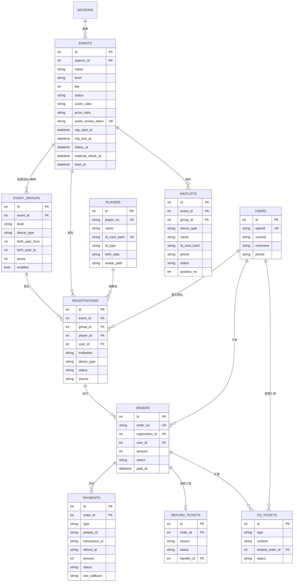
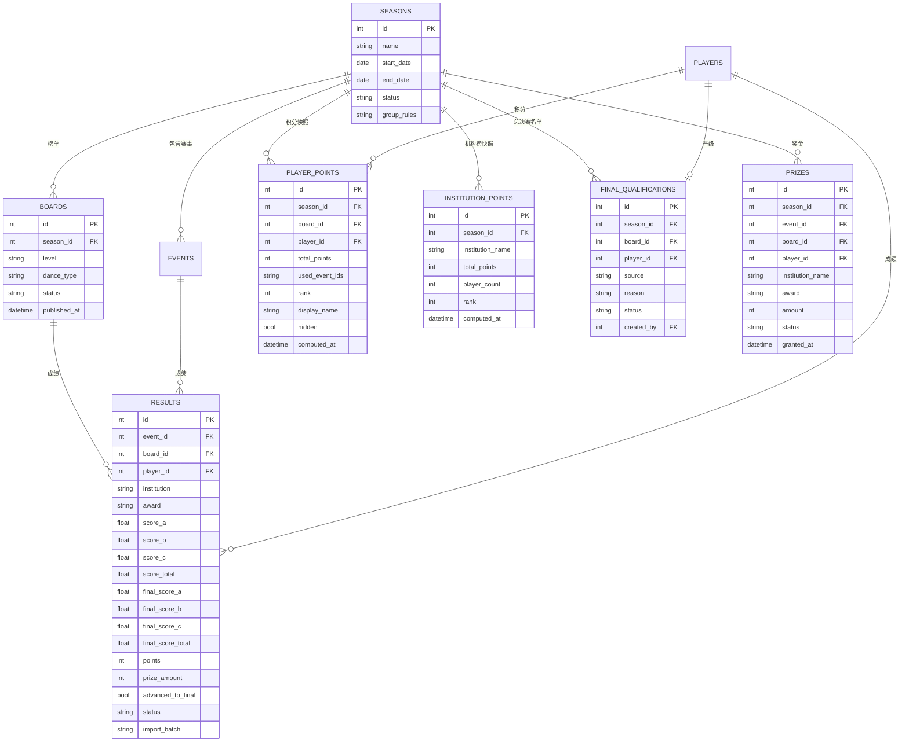

# 优舞盟 数据库表结构设计（v2）

> 本文档与以下文档配套阅读：
> - [报名功能设计](../优舞盟报名功能.md)（业务流程与状态机）
> - [后台管理页面与功能设计](../后台管理/优舞盟后台管理页面与功能设计.md)
> - [小程序页面与功能设计](../小程序页面/优舞盟小程序页面与功能设计.md)
>
> 存储：SQLite（单机 Docker、数据量小）。所有表含 `created_at`/`updated_at`（TEXT，ISO8601 本地时间）除非另有说明。
> v2 变更：选手唯一字符串 ID、规则下沉到赛事级、机构归属报名单、组别×舞种可任意配置、音频审核分享页、证件号简单加密+哈希比对、手机号明文、不做旧数据迁移。
> v3 变更：证件号改为**不可逆哈希**（对比时重算哈希比对）；音频审核页改为**每赛事一个免登录 H5**（管理员/客服生成链接，选手自行核对）。
> v4 变更（T2 落地）：`event_groups` 增 `taken`（已占名额计数，原子条件 UPDATE 抢名额）；`orders` 增 `request_id` 幂等键与内部中间态 `pending_payment`；`registrations` 状态含 `pending_payment`；`results` 唯一索引限定 `status='published'`（纠错保留留痕）；`refund_tickets` 状态含 `refund_failed`。
> v4 变更（T10 落地）：`orders` 增 `prepay_id`（预下单幂等复用）。

## 0. 设计决策（先读）

| # | 决策 | 理由 |
|---|---|---|
| 1 | **选手以系统生成的字符串 ID（player_no）为唯一标识**：8 位大小写字母+数字随机生成 | 系统内部所有引用走 player_no；证件号是外部世界对齐选手的手段，不是系统主键 |
| 2 | **证件号：不可逆哈希存储，不保存明文、无法还原**；对比时对输入再次哈希比对结果 | 哈希算法建议 HMAC-SHA256 + 服务端密钥（身份证熵低，裸 SHA-256 可被彩虹表反查）；满足"不可逆、方便对比"的要求 |
| 3 | **积分规则、奖金规则挂在赛事（events）上，不挂赛季** | 每场比赛独立配置；赛季只做时间范围与归档 |
| 4 | **机构归属报名单（registrations），不属于选手** | 同一选手不同场次可代表不同机构甚至个人名义参赛 |
| 5 | **组别配置粒度 = 赛事 × 组别 × 舞种（event_groups）** | 支持"某赛事只有 U11 + 单舞种"等任意子集配置；名额也按该粒度设置 |
| 6 | **榜单采用预计算快照表**（player_points / institution_points） | 成绩发布/纠错时同步重算快照，小程序端只读快照，O(1) 查询 |
| 7 | **榜单与报名"弱关联"** | 按已定需求两者业务独立；唯一交汇点是选手身份——成绩录入时按证件号匹配/建档选手；机构榜的取数来自成绩录入时记录的机构字段 |
| 8 | **音频审核页：每赛事一个免登录 H5，管理员/客服侧生成链接** | 针对赛事生成唯一 URL，访问无限制，选手打开后找到自己的条目试听核对音频；无资料审核环节不变 |
| 9 | **资料字段直接挂在报名单上** | 资料项固定（证件照/音频/节目名等 8 项），无审核流程，不需要单独的 materials 表 |
| 10 | **不做旧 JSON 数据迁移** | 本系统为全新赛季准备；`data/` 下旧数据仅作历史参考 |

## 1. ER 关系图

### 1.1 报名与支付域

### 1.2 榜单与积分域

## 2. 表结构明细

### 2.1 用户与选手

**users — 微信用户**

| 字段 | 类型 | 说明 |
|---|---|---|
| id | INTEGER PK | |
| openid | TEXT NOT NULL UNIQUE | 微信 openid，静默登录创建 |
| unionid | TEXT | 可空 |
| nickname | TEXT | 微信昵称（可空） |
| avatar_url | TEXT | 头像（可空） |
| phone | TEXT | 绑定手机号，**明文存储**，列表展示脱敏 |
| status | TEXT DEFAULT 'active' | active / blocked |
| last_login_at | TEXT | |

**players — 选手档案**

| 字段 | 类型 | 说明 |
|---|---|---|
| id | INTEGER PK | |
| player_no | TEXT NOT NULL UNIQUE | **系统内唯一字符串 ID**：8 位大小写字母+数字随机生成，对外展示与引用的主标识 |
| name | TEXT NOT NULL | 姓名 |
| id_card_hash | TEXT UNIQUE | 证件号 **HMAC-SHA256（服务端密钥）哈希**；**判重、报名、成绩导入匹配的唯一依据**；不可逆，不存明文、无法还原 |
| id_type | TEXT DEFAULT 'id_card' | id_card（身份证）/ passport（护照等其他证件） |
| gender | TEXT | 由证件号解析，可空 |
| birth_date | TEXT | 出生日期，报名/建档时解析写入（组别判定依据） |
| avatar_path | TEXT | 头像文件相对路径（`uploads/avatars/{player_no}/...`）：该选手**最近一次报名上传的证件照压缩副本**；榜单/选手详情头像取此字段，赛后赛事媒体清理不影响 |
| merged_into | INTEGER FK→players | 重复档案合并指向（同证件号哈希判重） |

> - 系统内所有关联（成绩、积分、晋级）走 `player_no` / `id`；证件号只在报名与成绩导入时用于"确认这是同一个人"。
> - 匹配/判重：对输入证件号用同一密钥重算 HMAC，比对哈希值；数据库与接口层**永远不出现证件号明文**（含日志）。
> - 因此后台不存在"明文查看证件号"功能，admin_logs 中对应审计项取消。
> - 头像：`avatar_path` 指向独立于赛事目录的稳定副本（`uploads/avatars/{player_no}/`），每次证件照上传成功后覆盖更新（旧头像异步删除）；不记录历史头像列表。

### 2.2 赛事与报名支付

**seasons — 赛季（只做时间范围与归档，不挂规则）**

| 字段 | 类型 | 说明 |
|---|---|---|
| id | INTEGER PK | |
| name | TEXT NOT NULL | 如「2027 赛季」 |
| start_date / end_date | TEXT | |
| status | TEXT DEFAULT 'upcoming' | upcoming / active / archived |
| group_rules | TEXT (JSON) | 系统级组别年龄规则（只读）：U11/U13/U15 出生年份范围、计算截止日；创建赛事组别时从此复制 |
| archived_at | TEXT | 归档时间 |

**events — 赛事（积分/奖金规则随赛事配置）**

| 字段 | 类型 | 说明 |
|---|---|---|
| id | INTEGER PK | |
| season_id | INTEGER FK | 关联赛季 |
| name | TEXT NOT NULL | |
| level | TEXT NOT NULL | 甲级赛 / 超级赛 / 年度总决赛 |
| city / venue | TEXT | 举办城市 / 地点 |
| event_date | TEXT | 比赛日期 |
| fee | INTEGER NOT NULL DEFAULT 0 | 报名费（分） |
| cover_path | TEXT | 封面图 |
| reg_start_at / reg_end_at / lottery_at / material_check_at / start_at | TEXT | 时间线 5 节点，强制先后 |
| status | TEXT DEFAULT 'draft' | draft / unpublished / registering / reg_closed / ongoing / finished / offline |
| score_rules | TEXT (JSON) | **本场积分规则**：名次基础分表、人数系数、级别权重（创建赛事时填写，默认模板预填，可改） |
| prize_rules | TEXT (JSON) | **本场奖金规则**：各名次金额、参赛人数分档（创建赛事时填写，默认模板预填，可改） |
| refund_policy | TEXT | 退费政策文案（默认模板可改） |
| work_duration_limit | TEXT | 作品时长要求（默认 ≤3 分钟） |
| process_desc / honor_desc | TEXT | 比赛流程 / 荣誉奖金说明 |
| exclude_from_prize | INTEGER DEFAULT 0 | 特殊场次不自动核算奖金（如 7 月巅峰赛） |
| audio_review_token | TEXT UNIQUE | 音频审核页标识：8 位大小写字母+数字，发布赛事后由管理员生成/重新生成；为空则审核页不可访问 |

**event_groups — 赛事组别×舞种配置**

> 一行 = 一个可报名单元。创建赛事时按需要勾选（如只勾 U11×古典舞 → 该赛事仅此一个报名单元），名额也按此粒度设置。

| 字段 | 类型 | 说明 |
|---|---|---|
| id | INTEGER PK | |
| event_id | INTEGER FK NOT NULL | |
| level | TEXT NOT NULL | U11 / U13 / U15 |
| dance_type | TEXT NOT NULL | 古典舞 / 民族民间舞 |
| birth_year_from / birth_year_to | INTEGER | 出生年份范围，创建时从 seasons.group_rules 复制（系统规则只读） |
| quota | INTEGER NOT NULL | 该 组别×舞种 名额；发布后只能调大 |
| taken | INTEGER NOT NULL DEFAULT 0 | 已占名额计数：提交报名事务内原子更新 `taken = taken + 1 WHERE taken < quota`；取消/退款时自减 |
| enabled | INTEGER DEFAULT 1 | 开关（关闭不影响已支付报名） |

> 名额校验：以 `event_groups.taken` 为准（提交报名即占位、取消即释放），禁止"先 SELECT 再 UPDATE"两步写法；SQLite 单写入者天然串行。

**registrations — 报名单**

| 字段 | 类型 | 说明 |
|---|---|---|
| id | INTEGER PK | |
| event_id / group_id / player_id / user_id | INTEGER FK | 赛事 / 组别×舞种 / 选手 / 提交人 |
| dance_type | TEXT NOT NULL | 冗余自 event_groups，便于查询 |
| institution | TEXT | **所属机构（本场有效）**：可空 = 个人名义 |
| status | TEXT NOT NULL | pending_payment（已提交待支付回调）/ active（已支付有效）/ canceled / withdrawn（退赛） |
| source | TEXT DEFAULT 'miniapp' | miniapp / manual（客服人工通道） |
| cs_ticket_id | INTEGER FK 可空 | 人工报名关联的客服工单 |
| photo_path | TEXT | 证件照**相对路径**（`uploads/{event_id}/{player_no}/随机名.jpg`，png/jpg ≤10MB）；赛后清理置 NULL |
| audio_path | TEXT | 舞蹈音频**相对路径**（`uploads/{event_id}/{player_no}/随机名.mp3`，mp3 ≤100MB ≤4分钟）；赛后清理置 NULL |
| program_name | TEXT | 节目名称 |
| teacher_name | TEXT | 指导教师（可选） |
| contact_phone | TEXT | 联系电话（明文） |
| express_address | TEXT | 快递地址（可选） |
| work_intro | TEXT | 作品说明（可选） |
| special_req | TEXT | 特殊要求（可选） |
| material_updated_at | TEXT | 资料最近更新时间 |

> 约束：
> - `UNIQUE(player_id, group_id) WHERE status IN ('pending_payment','active')` —— 同一 组别×舞种 只能有一条进行中报名（**必须含 pending_payment**，否则同一人可同时挂多个待支付单；部分索引，SQLite 支持）
> - 证件号判重 → 同一 player 自然无法重复报名；跨微信报名同证件号命中同一 player
> - "资料是否传齐"由字段是否为空实时计算，不存状态

> **文件存储约定（2026-11-11 定稿）**：
> - 媒体文件存磁盘 `uploads/{event_id}/{player_no}/`，文件名服务端随机生成（不用客户端原名，防覆盖与路径穿越）；表中只存相对路径。
> - 对前端暴露的访问前缀 `/static/materials/{event_id}/{player_no}/`、`/static/avatars/{player_no}/` 分别映射到 `uploads/` 对应目录；原图不公开目录列表。
> - `uploads/` 不入库、不进镜像，生产挂 volume；上传先落临时文件 → 校验 → 原子移动 → 更新 DB。
> - 证件照上传成功后同步生成压缩副本到 `uploads/avatars/{player_no}/` 并更新 `players.avatar_path`。
> - 赛事结束后删除 `uploads/{event_id}/` 并将 `photo_path`/`audio_path` 置 NULL；`uploads/avatars/` 永久保留。

**orders — 订单（全量留档）**

| 字段 | 类型 | 说明 |
|---|---|---|
| id | INTEGER PK | |
| order_no | TEXT NOT NULL UNIQUE | 商户订单号 out_trade_no |
| registration_id | INTEGER FK NOT NULL | |
| user_id | INTEGER FK NOT NULL | |
| amount | INTEGER NOT NULL | 金额（分） |
| status | TEXT NOT NULL | pending_payment（创建即插入的内部中间态，接口不暴露）/ paid / canceled / refunding / refunded |
| request_id | TEXT | 小程序提交报名时生成的幂等键（UUID），网络重试复用 |
| prepay_id | TEXT | 微信预支付单号（T10 预下单幂等复用，条件写入 `status='pending_payment' AND prepay_id IS NULL`） |
| paid_at / canceled_at | TEXT | |
| cancel_reason | TEXT | 用户取消 / 支付失败 / 系统关闭（user_cancel / pay_failed / system） |

> 状态机与报名功能文档 2.5 一致：用户侧无"待支付"页面状态，`pending_payment` 仅为服务端中间态；`refunding → refunded / paid（驳回）`。
> 幂等：`UNIQUE(user_id, request_id) WHERE request_id IS NOT NULL`，命中时直接返回已有订单，不重复创建。

**payments — 支付流水（对账 + 回调幂等）**

| 字段 | 类型 | 说明 |
|---|---|---|
| id | INTEGER PK | |
| order_id | INTEGER FK NOT NULL | |
| type | TEXT NOT NULL | pay / refund |
| prepay_id | TEXT | 微信支付预支付单号 |
| transaction_id | TEXT UNIQUE | 微信支付订单号（回调写入，幂等键） |
| refund_id | TEXT | 微信退款单号（部分唯一索引：`WHERE refund_id IS NOT NULL`，退款回调幂等键） |
| amount | INTEGER NOT NULL | |
| status | TEXT NOT NULL | success / failed / closed |
| raw_callback | TEXT (JSON) | 原始回调报文，对账与排查用 |
| notified_at | TEXT | 回调处理时间 |

**refund_tickets — 退款工单**

| 字段 | 类型 | 说明 |
|---|---|---|
| id | INTEGER PK | |
| ticket_no | TEXT UNIQUE | |
| order_id | INTEGER FK NOT NULL | |
| reason | TEXT NOT NULL | 退款诉求 |
| applicant | TEXT | 用户本人 / 客服代录 |
| status | TEXT DEFAULT 'pending' | pending / processing / approved / rejected / refunded（退款回调完成）/ refund_failed（微信退款接口失败，可重试） |
| handler_id | INTEGER FK→admins | 处理管理员 |
| reject_reason | TEXT | 驳回原因 |
| handled_at | TEXT | |
| created_by | INTEGER FK→admins | 登记人（客服/管理员，T15 新增；客服只看自己登记的工单） |

**waitlists — 候补队列**

| 字段 | 类型 | 说明 |
|---|---|---|
| id | INTEGER PK | |
| event_id / group_id | INTEGER FK | |
| user_id | INTEGER FK→users 可空 | 提交候补的微信会话（「我的候补」与自助取消按此归属；T14 新增） |
| dance_type | TEXT | |
| name | TEXT | 候补人姓名 |
| id_card_hash | TEXT | 证件号哈希（规则同 players，可空——无证件号的特殊登记只留姓名电话） |
| id_card_masked | TEXT | 脱敏证件号（后台列表展示；不可由哈希反推，提交时保存，T14 新增） |
| institution | TEXT | 所属机构 |
| phone | TEXT NOT NULL | 联系电话（明文，候补必填） |
| status | TEXT DEFAULT 'waiting' | waiting / notified / converted / given_up / removed |
| position_no | INTEGER | 队列序号（同一 event_id + group_id 内 MAX+1） |
| notified_at / handled_at | TEXT | |

**cs_tickets — 客服工单**

| 字段 | 类型 | 说明 |
|---|---|---|
| id | INTEGER PK | |
| type | TEXT NOT NULL | refund（退款诉求）/ no_id_card（无证件号报名）/ waitlist（候补咨询）/ other |
| user_name / phone | TEXT | 用户标识 |
| content | TEXT NOT NULL | 诉求内容 |
| related_order_id | INTEGER FK 可空 | |
| related_registration_id | INTEGER FK 可空 | 人工报名产生 |
| status | TEXT DEFAULT 'pending' | pending / processing / done |
| remark | TEXT | 跟进备注 |
| created_by | INTEGER FK→admins | 客服/管理员代录 |

### 2.3 榜单与积分

**boards — 榜单（默认每赛季 6 个：U11/U13/U15 × 古典舞/民族民间舞；赛事只覆盖其中一部分则只录有成绩的榜）**

| 字段 | 类型 | 说明 |
|---|---|---|
| id | INTEGER PK | |
| season_id | INTEGER FK | |
| level | TEXT NOT NULL | U11 / U13 / U15 |
| dance_type | TEXT NOT NULL | 古典舞 / 民族民间舞 |
| status | TEXT DEFAULT 'active' | |
| published_at | TEXT | |

**results — 成绩（赛事 × 榜单 × 选手 一条）**

| 字段 | 类型 | 说明 |
|---|---|---|
| id | INTEGER PK | |
| event_id / board_id / player_id | INTEGER FK | |
| institution | TEXT | **该场所属机构**：成绩录入时取报名单的机构（搜索辅助）或手动填写；机构榜按此聚合 |
| award | TEXT NOT NULL | 英文枚举键：champion / runner_up / third / elite_dancer / special_gold / gold / silver（展示层转中文） |
| score_a / score_b / score_c / score_total | REAL | 常规赛评委分（总分可由三席求和得出） |
| final_score_a / final_score_b / final_score_c / final_score_total | REAL | 决赛评委分（未晋级决赛为空） |
| points | INTEGER NOT NULL | 本场积分（按 events.score_rules 计算后固化） |
| prize_amount | INTEGER DEFAULT 0 | 本场奖金（分，按 events.prize_rules 核算） |
| advanced_to_final | INTEGER DEFAULT 0 | 是否晋级决赛 |
| remark | TEXT | 备注 |
| status | TEXT DEFAULT 'published' | published / corrected / voided（纠错与作废全程留痕） |
| import_batch | TEXT | Excel 导入批次号（在线录入可空） |
| created_by | INTEGER FK→admins | |

> 唯一约束：`UNIQUE(event_id, board_id, player_id) WHERE status='published'` —— 每场赛事每个榜单每名选手只有一条当前有效成绩；纠错时旧记录置 `corrected` 留痕，新记录重新发布，不冲突。

**player_points — 选手积分快照（发布/纠错成绩时重算）**

| 字段 | 类型 | 说明 |
|---|---|---|
| id | INTEGER PK | |
| season_id / board_id / player_id | INTEGER FK | |
| total_points | INTEGER NOT NULL | 取年度积分最高的 3 场之和 |
| used_event_ids | TEXT (JSON) | 实际计入的场次 ID（不足 3 场按实际） |
| rank | INTEGER | 榜内排名（隐藏选手不占位） |
| display_name | TEXT | 展示名设置（真名 / 化名 / 编号），空=真名 |
| hidden | INTEGER DEFAULT 0 | 隐藏上榜 |
| computed_at | TEXT | |

**institution_points — 机构年度榜快照**

| 字段 | 类型 | 说明 |
|---|---|---|
| id | INTEGER PK | |
| season_id | INTEGER FK | |
| institution_name | TEXT NOT NULL | |
| total_points | INTEGER NOT NULL | 旗下选手年度积分之和（按 results.institution 聚合） |
| player_count | INTEGER | 上榜选手数 |
| rank | INTEGER | |
| computed_at | TEXT | |

**final_qualifications — 总决赛资格名单（直通卡 + 积分晋级 + 手动调整）**

| 字段 | 类型 | 说明 |
|---|---|---|
| id | INTEGER PK | |
| season_id / board_id / player_id | INTEGER FK | |
| source | TEXT NOT NULL | auto_direct（甲级第1/超级前2 自动直通）/ manual_direct（手动增补直通）/ points（积分前20顺延）/ manual（手动调整） |
| reason | TEXT | 手动操作必填原因 |
| status | TEXT DEFAULT 'valid' | valid / canceled |
| created_by | INTEGER FK→admins | |

**prizes — 奖金明细单（按赛事的 prize_rules 核算）**

| 字段 | 类型 | 说明 |
|---|---|---|
| id | INTEGER PK | |
| season_id | INTEGER FK | |
| event_id | INTEGER FK 可空 | 机构奖无赛事 |
| board_id | INTEGER FK 可空 | |
| player_id | INTEGER FK 可空 | |
| institution_name | TEXT 可空 | 机构奖 |
| award | TEXT NOT NULL | 奖项名 |
| amount | INTEGER NOT NULL | 金额（分） |
| status | TEXT DEFAULT 'pending' | pending / granted / skipped |
| granted_at | TEXT | 发放日期 |
| grantee_note | TEXT | 领取人/代领人、备注 |

### 2.4 系统表

**admins — 后台管理员**

| 字段 | 类型 | 说明 |
|---|---|---|
| id | INTEGER PK | |
| username | TEXT NOT NULL UNIQUE | 登录账号 |
| name | TEXT 可空 | 真实姓名（后台展示用；启动种子创建的超管默认「超级管理员」） |
| password_hash | TEXT NOT NULL | bcrypt |
| role | TEXT NOT NULL | super_admin / admin / cs（客服） |
| status | TEXT DEFAULT 'active' | |
| last_login_at | TEXT | |

**admin_logs — 操作日志（留痕：明文证件号查看、成绩纠错、退款、手动晋级等）**

| 字段 | 类型 | 说明 |
|---|---|---|
| id | INTEGER PK | |
| admin_id | INTEGER FK | |
| action | TEXT NOT NULL | 操作类型 |
| target_type / target_id | TEXT / INTEGER | 操作对象 |
| detail | TEXT (JSON) | 操作详情 |
| created_at | TEXT | |

**settings — 键值配置**

| 字段 | 类型 | 说明 |
|---|---|---|
| key | TEXT PK | 如 advance_quota、公告文案、公众号二维码、积分规则说明页内容 |
| value | TEXT (JSON) | |
| updated_at | TEXT | |

## 3. 成绩 Excel 导入模板

模板文件：`data/excel/国舞 成绩单&排名单 2026年7月.xlsx`，列结构（按 sheet：每个 组别×舞种 一个 sheet）：

| 列 | 必填 | 说明 |
|---|---|---|
| 序号 / 选手序号 | | 忽略（导入时系统重排） |
| 姓名 | 建议 | 证件号匹配成功后以档案为准；匹配失败时用于新建档案 |
| **身份证** | **必填** | 唯一匹配键：命中 player 档案直接带出；未命中按行内姓名/机构新建档案 |
| 积分赛 | | 忽略（由所选赛事决定级别权重） |
| 组别 / 舞种 | | 忽略（由导入时选择的榜单决定） |
| 剧目 | | 可空 |
| 指导老师 | | 可空 |
| 所属机构 | | 可空；写入 results.institution（机构榜取数来源） |
| **成绩（奖项）** | **必填** | 冠军/亚军/季军/菁英舞者/特金奖/金奖/银奖 |
| 本站积分 | | 忽略（系统按 score_rules 计算） |
| **常规赛评委A/B/C** | **必填** | 原始分数；总分 = 三席之和 |
| 决赛评委A/B/C | 晋级者必填 | 未晋级留空；advanced_to_final 依此判定 |
| 2场总得分 | | 忽略（系统可算） |

导入流程不变：解析 → 按证件号哈希匹配/建档 players → 预览（总行数、匹配成功/失败数）→ 确认写入 results（记 import_batch）→ 重算快照与奖金。

## 4. 关键流程与表的对应

| 流程 | 涉及表 |
|---|---|
| 静默登录 | users（按 openid upsert） |
| 提交报名 | 校验 event/event_group → 按 id_card_hash 匹配/新建 players（发 player_no）→ 事务内原子占名额（event_groups.taken）→ 创建 registrations(pending_payment) + orders → 拉起支付 |
| 支付回调 | payments（按 transaction_id 幂等）→ orders(paid) → registrations(active) |
| 取消/失败 | payments → orders(canceled) → registrations(canceled) + event_groups.taken 自减（名额即时释放） |
| 上传音频 | registrations.audio_path 更新（material_updated_at 刷新）；音频审核页内容自动包含该报名 |
| 音频审核页 | 管理员/客服在后台针对赛事生成/复制 H5 链接（events.audio_review_token）→ 发给选手 → 选手免登录打开，找到自己的条目试听核对 |
| 人工退款 | cs_tickets 登记 → refund_tickets → 后台同意 → 微信退款 API → payments(refund) → orders(refunded) → registrations(withdrawn) |
| 候补 | waitlists 排队 → 退赛释放名额 → 管理员电话通知 → 用户走正常报名（converted） |
| Excel 成绩导入 | 解析 → players 按 id_card_hash 匹配/建档 → results（import_batch，institution 取行内或报名单）→ 按 events.score_rules 重算 player_points / institution_points → 按 events.prize_rules 生成 prizes |
| 直通卡/晋级 | 成绩发布后写 final_qualifications（auto_direct）→ 积分前 20 顺延（points）→ 手动调整（留痕） |
| 奖金发放 | prizes 生成 → 人工微调 → 登记 granted → 导出 |

## 5. 音频审核页（H5）

- **形态**：纯 H5 页面，针对**每场赛事**一个独立 URL，形如 `/audio-review/{events.audio_review_token}`，**访问无限制、免登录**，谁拿到链接谁都能打开。
- **生成与使用（管理员/客服侧）**：赛事详情页提供"生成审核链接 / 重新生成"按钮；token 为 8 位大小写字母+数字，重新生成后旧链接立即失效。管理员/客服把链接发给选手，选手打开后自行核对。
- **页面内容**：该赛事所有 `status='active'` 且已上传音频的报名列表——选手姓名（或榜单展示名）、节目名、内嵌音频播放器；支持按姓名搜索定位。音频更新后页面内容实时反映。
- **安全边界**：页面只含选手姓名、节目名、音频三类信息，**不含**证件号、电话、机构、订单等任何敏感数据；token 不可枚举（随机 8 位 62 进制 ≈ 2.2×10¹⁴ 组合）。

## 6. 待细化

- [ ] 积分规则 JSON schema（名次基础分表、人数系数分档——默认按 FAQ，每场可覆盖）
- [ ] 奖金规则 JSON schema（各级别各名次金额、人数分档）
- [ ] 证件号哈希的服务端密钥管理（环境变量注入，Docker 部署时配置）
- [ ] 音频审核页细节：列表排序规则（按组别/报名时间/姓名？）、是否默认只展示已传音频的报名
